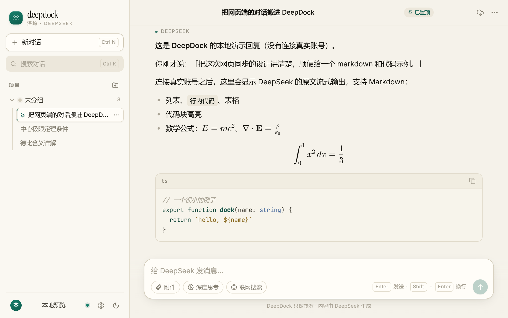
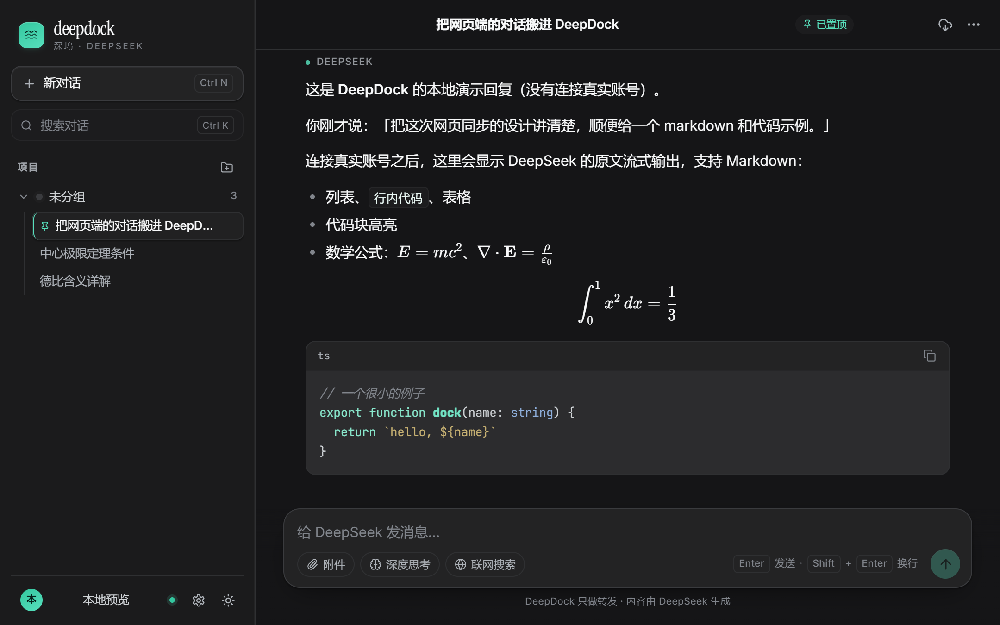
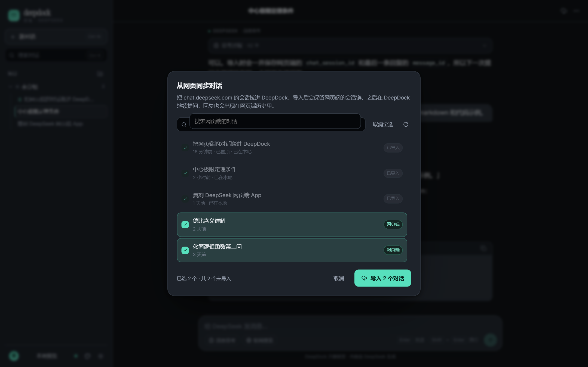
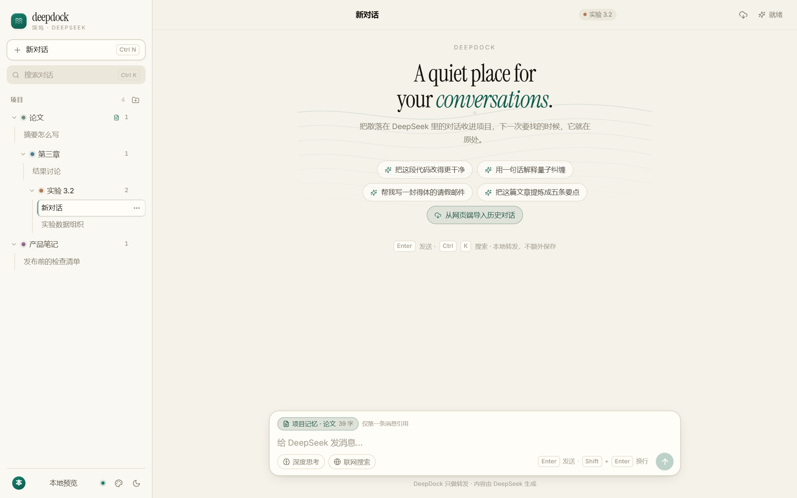
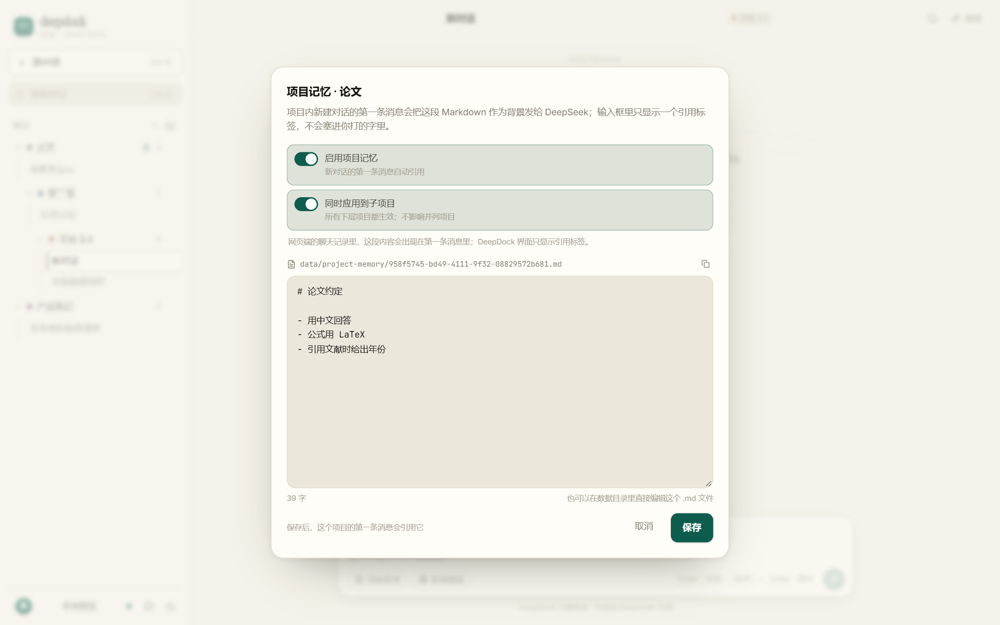
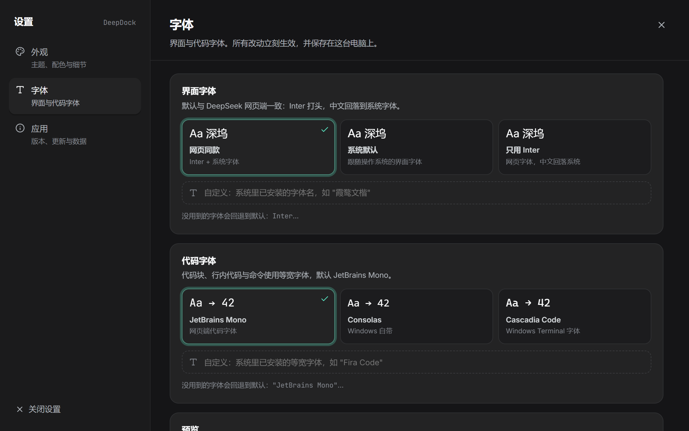

# DeepDock · 深坞

一个安静的 DeepSeek 桌面客户端。它只做三件事：**转发对话**、**把对话收进项目**、**让你找得到**。

- 没有花活：不写系统提示词、不注入上下文、没有 Agent / 工具；图片和文件直接上传到同一个网页会话。
- 对话由 DeepSeek 官方网页接口生成，DeepDock 只在本机中转。
- 数据全部躺在你电脑上，纯 JSON，随时能备份、grep、手改。
- Windows 桌面应用（Electron），双击即用，不需要额外装 Node 或浏览器。





<details>
<summary>从网页同步对话 / 项目树与项目记忆 / 设置与字体</summary>








</details>

## 下载与安装

从 [Releases](https://github.com/Enkrid-Rao/deepdock/releases) 下载，Windows 10 / 11 x64：

| 包 | 说明 |
| --- | --- |
| `DeepDock-Setup-*.exe` | 安装版，可选安装目录，创建开始菜单 / 桌面快捷方式 |
| `DeepDock-*-win-x64.zip` | 绿色版，解压后直接运行 `DeepDock.exe` |

第一次打开会进入连接页。桌面版会**自动**从本机 Chrome / Edge 读出 `chat.deepseek.com` 的登录凭证并验证，
成功就直接进入；万一读不到（比如只用无痕窗口、或浏览器里没登录），再按页面上的三步手动粘贴一次。

两种包的数据都在 `%APPDATA%\DeepDock\`，安装版卸载时**不会**删除对话数据。

安装版会自己检查更新：启动 15 秒后查一次 GitHub Releases，之后每 6 小时查一次；新版本在后台下载完再问你要不要重启安装（选「稍后」就是下次退出时装）。手动检查在左下角头像菜单 →「检查更新」。

> 未签名的自编译程序，首次运行时 SmartScreen 可能提示「Windows 已保护你的电脑」，
> 点「更多信息 → 仍要运行」即可。

## 开发

```bash
npm install
npm run build        # 构建前端
npm run desktop      # 以桌面应用方式启动（需要已 build）
npm run dev          # 或者用浏览器开发：前端 5181 / 后端 5180
node scripts/check-auth.mjs --validate   # 诊断浏览器登录读取
```

重新打包：

```bash
npm run package      # 绿色目录 → release/DeepDock-win32-x64/
npm run installer    # 安装包 + 绿色 zip → release/builder/
npm run icon         # 重新生成 build/icon.ico
```

纯浏览器模式也保留着（`npm start` → <http://127.0.0.1:5180>），方便调 UI。

### 发布新版本

自动更新按 `latest.yml` 里的版本号比较，所以**版本号、tag、Release 资源三者必须对得上**，
也不要在同一个版本号下悄悄换内容（已经装上的用户不会收到更新）：

1. 改 `package.json` 的 `version`：新功能升 minor，修复升 patch；
2. `npm run installer`，产物在 `release/builder/`；
3. `git commit`、打 tag（如 `v1.3.0`）、`git push --follow-tags`；
4. 在 GitHub 建同名 Release，上传这几个文件（**缺 `latest.yml` 更新就不会生效**）：
   - `DeepDock-Setup-<version>.exe`
   - `DeepDock-Setup-<version>.exe.blockmap`
   - `latest.yml`
   - `DeepDock-<version>-win-x64.zip`（绿色版，可选）
5. 已安装的旧版本会在 6 小时内（或手动「检查更新」）发现它并自动下载。

> 自动更新走 GitHub Releases，国内网络需要能访问 GitHub；应用跟随系统代理
> （Clash 打开「系统代理」即可），没有单独的代理设置项。

没有账号先看界面：

```powershell
$env:DEEPDOCK_MOCK='1'; npm run desktop
```

调试时想用独立数据目录（不影响 `%APPDATA%\DeepDock`）：

```powershell
$env:DEEPDOCK_MOCK='1'; $env:DEEPDOCK_USER_DATA='D:\Temp\deepdock-dev'; npm run desktop
```

## 连接账号

DeepSeek 网页端的登录凭证**不在 Cookie 里**，而是存在浏览器的 localStorage 里，接口只认
`Authorization: Bearer <userToken>`。

### 自动方式（桌面版）

打开 DeepDock 时它会自己去浏览器里找一次；找不到才会停在连接页。连接页上的
「从本机 Chrome / Edge 读取并登录」也可以随时手动重试。

**为什么不用装浏览器扩展？** Chromium 系浏览器把每个站点的 localStorage 明文存在
用户目录下的一个 LevelDB 数据库里（`<profile>/Local Storage/leveldb`）。DeepDock 的
主进程只读这个目录里的本地文件：

- `*.ldb` / `*.sst` 排序表：解析 LevelDB 的 block 格式，并用内置的 Snappy 解压；
- `*.log` 写前日志：解析未合并的最新写入；
- 只挑 `_https://chat.deepseek.com\x00\x01userToken` 这一条记录，并取版本号最新的值。

它不解密密码、不读 Cookie、不连调试端口、不上传任何东西；读到的 token 交给本机
`127.0.0.1` 上的 DeepDock API 校验，token 本身不会进入网页界面。
诊断脚本：

```bash
node scripts/check-auth.mjs            # 列出读到了哪些浏览器 / 哪几份 token（只显示指纹）
node scripts/check-auth.mjs --validate # 再问一次 DeepSeek 这些 token 是否还有效
```

早先的版本只对 LevelDB 文件做字符串搜索，遇到 Snappy 压缩过的块就找不到最新的 token，
反而会捞到已过期的旧值——这就是「网页明明登录着，DeepDock 却说凭证失效」的原因。

### 手动方式

1. 在已登录的浏览器打开 <https://chat.deepseek.com>，按 `F12` 打开控制台；
2. Console 里执行 `localStorage.getItem('userToken')`；
3. 复制输出的整段 JSON（形如 `{"value":"…","__version":"0"}`），粘贴到连接页。

连接页还有一个可选的 Cookie 输入框，贴上完整 `Cookie` 能让请求更像浏览器发出的，不是必需的。

凭证只写在 `%APPDATA%\DeepDock\data\credentials.json`（权限 0600），**不会**上传到任何地方。
DeepSeek 的 userToken 本身有效期很长，深坞会一直复用；如果哪天真的失效了，会在启动时或
生成失败后自动回浏览器再取一次，取不到才提示重新连接。

## 项目树与项目记忆

项目可以嵌套：项目行「⋯」→ **新建子项目**；编辑项目时也可以修改父项目，把它移动到另一层。
删除项目时，子项目会向上移动一层，不会被一起删掉。

每个项目还可以写一份 **Markdown 项目记忆**（项目行「⋯」→ 项目记忆…，或点项目名旁的小文件图标）：

- 项目内**新建对话的第一条消息**会把这份 Markdown 作为背景发给 DeepSeek；
- 输入框和消息里只显示「项目记忆 · 项目名」引用标签，正文不会塞进你打的字；
- 默认只作用于本项目；打开「同时应用到子项目」后，所有后代项目的第一条消息也会引用它；
- 记忆文件存在 `data/project-memory/<项目 id>.md`，可以直接用编辑器修改；
- 网页端的聊天记录里，这段内容会出现在第一条消息里（DeepSeek 接口只接受文本 prompt）；DeepDock 界面只显示引用标签；
- 关闭开关或清空内容就不会引用；子项目自己也可以有独立的记忆，会按「根项目 → 子项目」顺序拼接。

> 项目记忆会作为 prompt 的一部分发给 DeepSeek，请不要把密钥、密码等敏感信息写进去。

## 从网页同步对话

头像菜单 / 顶栏云朵按钮 / `Ctrl + K` 都能打开「从网页同步对话」：

- 列出 `chat.deepseek.com` 上的历史会话（支持搜索；「加载全部」一次读完，或者滚到底部自动继续加载）；
- 选择后导入到本地，保留标题、时间、置顶、思考过程；
- 同时保存 `chat_session_id` 和最后一条回复的 `message_id`，所以导入后可以**接着同一个
  网页会话继续聊**，新回复也会出现在网页端历史里；
- 已经导入过的会标记「已导入」，不会重复建一份；
- 对已经导入的对话，顶栏「⋯」里的「从网页同步这段对话」会把网页端后来新增的回复补到本地；
- 图片 / 文件消息会一起导入：图片从网页端的文件 CDN 预览，文档显示成附件卡片。

## 设置

左下角齿轮 / 头像菜单 →「设置」，或者按 `Ctrl + ,`，打开独立的设置页，分三栏：

**外观**

- 模式：浅色 / 深色 / 跟随系统；
- 浅色风格：暖纸、瓷白、雾蓝、淡绿；
- 深色风格：**现代黑**（默认）、暖夜、石墨蓝、森林黑。
  「现代黑」对齐 chat.deepseek.com 的深色配色：`#151517` 底、`#1b1b1c` / `#232324` / `#2c2c2e` 分层灰面、`#f9fafb` 主文字，和 VS Code 一类 Modern Dark 观感一致；
- 强调色：翡翠、海蓝、深坞蓝（DeepSeek 网页端的蓝）、青、紫罗兰、琥珀、玫瑰；
- 细节：衬线标题、纸张颗粒、减少动效。

**字体**

- 界面字体默认与网页端一致：**Inter + 系统无衬线**（中文回落到系统字体），也可以换成「系统默认」「只用 Inter」；
- 代码字体默认是 **JetBrains Mono**，另有 Consolas、Cascadia Code；
- 两处都可以填**任意本机已安装的字体名**（例如 `"霞鹜文楷"`、`"Fira Code"`），下面有实时预览；没装到的字体会自动回落到默认栈。

**应用**

- 版本、Electron 版本和数据目录；
- 检查更新、打开数据目录；
- 一键恢复默认外观与字体。

所有选择立即生效并保存在本机；Electron 窗口的底色也会跟着变，不会在启动时闪白。

## 功能

| 功能 | 说明 |
| --- | --- |
| 项目分组 | 新建 / 重命名 / 删除项目；**项目可嵌套**；对话随时「移动到项目」；项目只用于分组，不参与任何提示词 |
| 项目记忆 | 每个项目可选一份 Markdown 记忆文件，项目内新对话的第一条消息以引用标签的形式带上它；可设置是否包含子项目 |
| 网页历史同步 | 把 chat.deepseek.com 的历史会话导入本地，导入后继续对话会写回同一个网页会话 |
| 自动保持登录 | 启动时自动从本机浏览器读取并验证 token；失效时自动续取，不必反复粘贴 |
| 置顶 | 重要对话钉在列表顶部 |
| 搜索 | 侧栏即时过滤；`Ctrl + K` 打开全局搜索面板 |
| 图片与文件 | 粘贴、拖入或点「附件」上传图片 / 文档，发送时挂在同一个网页会话里；图片直接预览，文档显示成卡片；从网页导入的附件也能看 |
| 深度思考 | 使用 DeepSeek 的思考模式，思考过程可折叠查看（思考只进折叠区，不会混进回复正文） |
| 联网搜索 | 透传 `search_enabled` 参数 |
| 流式输出 | 逐字渲染，Markdown / 代码高亮 / KaTeX 公式；`$…$`、`\(…\)`、`\[…\]` 三种写法都能渲染（代码块里保持原文） |
| 停止 / 重新生成 | 生成中可随时停止；对最后一条回复可重新生成 |
| 行内改名 | 点顶栏标题直接改；对话、项目都能重命名 |
| 设置页 | 独立的设置页（`Ctrl + ,`）：外观 / 字体 / 应用三栏；浅色 4 套、深色 4 套（默认「现代黑」，对齐网页端深色）；7 种强调色；衬线标题、纸张颗粒、减少动效 |
| 字体 | 界面字体默认 Inter + 系统字体（与网页端一致），代码字体默认 JetBrains Mono；可选预设，也可填任意本机字体并实时预览 |
| 桌面集成 | 窗口大小/位置记忆、单实例、外链走系统浏览器、一键打开数据目录 |
| 自动更新 | 安装版启动后自动检查 GitHub Releases，后台下载，提示重启安装；也可以从头像菜单「检查更新」手动触发 |
| 键盘 | `Ctrl+N` 新对话、`Ctrl+K` 搜索、`Esc` 关闭弹层、`Enter` 发送、`Shift+Enter` 换行 |

## 数据在哪

桌面版：`%APPDATA%\DeepDock\`

```
DeepDock\
├── data\
│   ├── index.json              项目 + 对话索引（标题、分组、置顶、时间）
│   ├── conversations\
│   │   └── <uuid>.json         单个对话的全部消息（含思考过程、附件、导入标记）
│   ├── attachments\
│   │   └── <file-id>.<ext>     上传过的附件原件（本机预览用）
│   ├── project-memory\
│   │   └── <project-id>.md     项目记忆（可外部编辑）
│   └── credentials.json        账号凭证（唯一含密钥的文件）
├── appearance.json             上次的窗口底色（避免启动闪白）
└── window-state.json           窗口尺寸 / 位置
```

从网页导入的对话也落在 `conversations/` 里，和本地新建的对话没有区别；只是多带了
`dsSessionId` / `dsMessageId`，用来继续网页端的会话链。头像菜单 →「打开数据目录」可以直接跳过去。
删掉 `data/` 就是恢复出厂设置，备份也是拷贝这个目录。

## 实现方式

```
Electron 主进程
 ├─ 在本机 127.0.0.1:5199 启动 DeepDock API（Express）
 └─ BrowserWindow 打开这个地址
      └─ 前端（React + Vite）通过 /api/* 与本机 API 对话
```

前端从不直接访问 DeepSeek，也不加载任何远程页面（`nodeIntegration: false`、`contextIsolation: true`）。
主进程只通过一个极小的 preload 桥暴露本地能力：窗口底色、打开数据目录、系统确认框，
以及「从本机浏览器取一次登录」——最后这个动作在主进程里完成扫描和校验，**token 不会进入渲染进程**。

直连的是 `chat.deepseek.com` 的网页内部接口：

| 接口 | 用途 |
| --- | --- |
| `GET /api/v0/users/current` | 校验 token、读取账号信息 |
| `POST /api/v0/chat_session/create` | 为每个本地对话建一个 DeepSeek 会话 |
| `GET /api/v0/chat_session/fetch_page` | 分页列出网页端历史会话 |
| `GET /api/v0/chat/history_messages` | 拉取某个会话的完整消息与思考片段 |
| `POST /api/v0/file/upload_file` | 上传图片 / 文档（PoW 用同一个挑战接口） |
| `GET /api/v0/file/fetch_files` | 查询附件解析状态与签名地址 |
| `POST /api/v0/chat/create_pow_challenge` | 取 PoW 挑战 |
| `POST /api/v0/chat/completion` | 发起对话（SSE 流） |

请求前会用 DeepSeek 官方页面同款的 SHA3 WASM 模块解一个 proof-of-work 挑战，
随请求以 `x-ds-pow-response` 头发送。WASM 内置在 `server/lib/sha3.wasm`，
如果官方换了算法，服务端会自动去官网拉一份新的。

浏览器凭证的读取实现在 `server/lib/browser-tokens.js`：一个只读的 LevelDB 读取器
（table footer / block / Snappy / WAL），同时被 Electron 主进程和 `scripts/check-auth.mjs` 使用。

## 边界

- 仅供个人自用；没有多账号、没有团队协作。
- 不是官方 API，接口随时可能变。变了就改 `server/lib/deepseek.js`。
- 不支持分享链接、语音；附件大小上限 100 MB、一次最多 50 个（DeepSeek 网页端的限制）。
- 网页端删除的会话不会自动从本地消失；导入过的对话以本地为准。
- 网页版账号被限流或临时封禁时，会在对话里给出错误提示。
